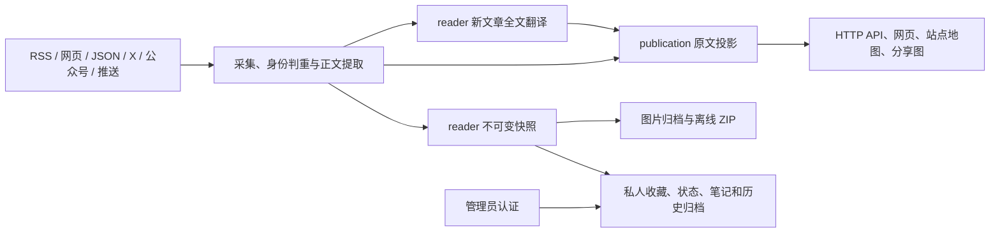

# 架构

## 进程与边界

`apps/api` 提供公开读取、后台和模块接口；`apps/worker` 处理来源采集、正文、归档、备份和运维任务；`apps/web` 只经 HTTP 读 API，不导入数据库或后端实现。数据库、凭据、付费调用和归档文件只在后端。

所有公开文章从 `packages/backend/src/publication/` 读取。`items.ts` 定义当前来源参与方式、人工下架与公开范围；`access.ts` 检查正文权限。正文即时发布不依赖模型，空作者/日期不补造，排序使用发布时间或收录时间。公开响应和公共归档资源采用 `no-store`，不提供陈旧结果兜底。

站内互动统计从启用时开始累计：进入文章详情记一次，同一浏览器对同一篇文章30分钟内去重；计数不表示读完或独立人数。匿名投票一票可取消；公开收藏统计尚未开放，界面显示“—”，管理员私人收藏仍经私人接口保护。清除 Cookie 或更换浏览器后无法把访问认作同一人。

人工修正保留在 `editorial_overrides`，通过版本检查和同事务审计提交。正文任务按修订检查结果，新版本、人工下架与旧任务相遇时，旧任务不得覆盖新状态。来源暂停不会删除投影。

主题目录保存在 `article_topics`，初始项由显式seed从行业模板导入，重复执行不覆盖管理员编辑。运行时通过publication读取数据库，不缓存主题项。名称与说明可在后台修改，slug和匹配标签保持稳定；编辑元数据不重写文章或发布投影。私人管理篇数沿用书库范围，公开主题统计仍经过统一可见性规则。

付费的全文翻译、Jina、SocialData、Dajiala 继续经过 `providers/receipts.ts` 的回执、费用历史和预算。`MODEL_CALLS_ENABLED`、`COLLECT_ENABLED`、`FEISHU_INTERNAL_ENABLED`、`INDEXNOW_SUBMIT_ENABLED` 只认字符串 `true`，默认关闭。页面打开不触发付费请求。

## 模块

`modules/reader` 包含私人状态/笔记、归档、API、页面、迁移和测试；由 `site/modules/{index,server,web}` 三份清单装配。前端模块只使用纯类型和 HTTP。认证通过已有 `adminHandler` 注入，所有私人接口带 `no-store`，写入需要 CSRF 和当前管理员会话。

正文事务发送确定的 `MaterialCapture`。快照按文章、正文修订和表示哈希去重；元数据变化也生成独立表示。资源使用内容哈希文件名，下载、像素和数量有上限；只有正文质量与所有必要图片均通过才标为完整。公共图片每次检查当前文章、当前全文许可及表示版本；历史版本只向管理员开放。

reader 通过事务内 `articleCreated` 登记新收录文章的翻译资格，后续 `articleMaterialStored` 更新其待翻译正文。独立排程每五分钟处理 pending 状态，按正文修订及原文 HTML 条件提交译文；旧文章不因重发正文事件加入。中文译文在公开读取层的现有全文门禁内装配，图片沿用精确原文快照；不可变私人快照和阅读位置继续对应原文。

ZIP 冻结文件映射，包含清洗后的 HTML、Markdown、图片和校验清单，不包含笔记或服务器路径。导出中的缺图明确标记。配套备份先 dump，冻结资源清单、校验并打包，最后发布完整组清单；归档资源不自动物理 GC。

## 数据库迁移

已发布迁移保持不变。核心迁移位于 `database/migrations/`，reader 表位于 `modules/reader/migrations/`；按完整文件名排序和记账，同一编号不同文件分别执行，完整文件名不能重复。

从 `0055` 起每文件一条允许语句。索引用 `CREATE INDEX CONCURRENTLY IF NOT EXISTS`；约束先 `NOT VALID` 再单独验证。不要在发布迁移批量 UPDATE/DELETE 或用 DO 隐藏操作。迁移脚本检查全套 SQL，不能关闭检查绕过失败。

本改造的 `0100_reader_drop_*` 会删除退休功能的表和列，**只在已明确的新阅读站数据库应用，不支持直接升级运营中的原站**。不使用 CASCADE；依赖未清理即失败。退休模型配置和预算用显式指定数据库名的 `scripts/retire-reader-state.ts` 清理并记录审计，费用回执历史保留；reader 翻译使用的 `llm` 预算保留，由 `scripts/init-reader-translation.ts` 显式初始化，迁移 `0104_reader_translations.sql` 只创建新的模块表，`0105_article_engagement.sql` 只创建互动统计表。数据影响和回退见 [部署](deploy.md#更新与回退)。

## 地址

匿名互动写入由 `operations/engagement.ts` 处理；公开路由只允许调用这一明确的写入用例，统计与浏览器点赞状态仍通过 `publication/engagement.ts` 读取。Cookie 编解码位于通用 `lib/cookies.ts`，匿名接口不依赖管理员认证层。浏览器在 HTTPS 或 localhost 上串行建立匿名身份，避免首次同时打开标签页覆盖 Cookie；Cookie 或浏览器同源锁不可用时显示失败提示，不提交互动。

公开页面：`/`、`/explore`、`/items/:id`。“文章”列表统一在 `/`，标题连续排列并按发布时间倒序；日期按上海时区显示，缺少发布时间时显示收录时间，摘要优先显示译文、最多两行。桌面侧栏独立显示类别，顶部主题导航提供两列“更多主题”浮层；手机使用类别与主题两个选择入口，底栏保留文章、探索、我的。标题右侧提供搜索，来源选择立即应用，日期在浮层中填写后应用。类别与主题筛选可取交集；类别和主题各自的“全部”入口只移除对应维度，保留搜索、来源和日期条件。列表显示匹配总数，支持数字页码、任意跳页及每页25/50/100篇（默认25）；切换筛选条件或每页篇数从第一页开始，每页篇数在URL与浏览器历史保留。探索默认展示主题，`?view=sources` 切换来源目录；两种目录的卡片及文章中的关联链接都进入 `/` 筛选。旧 `/all`、主题／来源目录和详情地址由共享 HTTP 策略重定向，查询条件保留，独立结果页面与专属分享卡已移除。列表筛选为 `sourceId/category/topic/from/to/q`，分页参数为正整数 `page` 和 `limit=25|50|100`，响应包含 `items/total/page/limit/pageCount`；日期筛选按上海日历日解释。计数与当前页在同一数据库语句内读取，按时间与ID倒序排列；超出末页时归到末页，空结果为page=1、pageCount=0。普通列表旧cursor参数已退休，私人书库的独立游标不变。站点地图列出探索和文章，不列出 noindex 的筛选结果或被重定向的旧页面。

后台 `/admin`，私人阅读库 `/admin/reader`，分类 `/admin/reader/categories`，主题管理 `/admin/reader/topics`。公开读取 API 为 `/api/site/`，私人 API 为 `/api/admin/reader/`；资源 `/api/reader/articles/:article/assets/:snapshot/:asset` 仍检查当前公开权限。`/sitemap.xml`、`/robots.txt` 和 `/og/` 保留。旧热点、报刊、RSS 输出、公开 v1、MCP、Agent Markdown 路由返回不存在。

边界由 `tests/architecture.test.ts` 检查；自动测试使用隔离数据库和本地假源。完整命令见 README。
